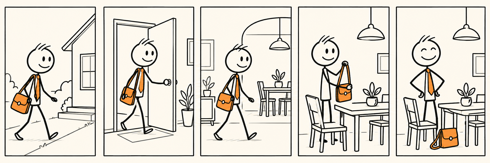

# AutoStickMan

AutoStickMan turns an idea or script into a fact-checked, stickman-style flipbook video. It is designed to be installed as an agent skill so another coding agent can run the same workflow:

`idea or script → web research → fact-checked narration → standalone scene images → voiceover → flipbook render → optional Instagram Reel`

The supplied cream-paper stickman image is the default visual reference. A user can provide a different reference image for a project, or accept the default.

## Visual preview

### YouTube-style storyboard image

This is the single horizontal storyboard image for the YouTube version. It is responsive and scales down to fit the README on smaller screens:



### Inline sample video

The complete sample uses captions synchronized to the actual Brian voice word boundaries. It is attached to GitHub so it renders as a player directly on this README. Use the controls in the player; it does not open the repository file viewer:

https://github.com/user-attachments/assets/1eb85865-25a0-4848-b268-0e144980f31a

The exact default generation reference is still preserved at `assets/default_style_reference.png`, but the README uses only the single YouTube-style image above.

## Install as a Codex skill

```bash
git clone https://github.com/aiwithenoch/AutoStickMan.git
cp -R AutoStickMan/skills/auto-stickman "${CODEX_HOME:-$HOME/.codex}/skills/auto-stickman"
```

Then start a coding-agent request such as:

> Use `$auto-stickman` to turn this idea into a fact-checked vertical stickman video. Ask me whether to use a custom reference image or the default one.

If the agent is already working inside this repository, it can read `skills/auto-stickman/SKILL.md` directly.

## What the installed skill does

1. Asks whether the user has a custom image reference. If not, it uses `assets/default_style_reference.png`.
2. Searches the web before writing the explanation and records sources near the factual claims.
3. Separates established science, company-published claims, and unverified or future claims.
4. Converts the story into a scene-by-scene storyboard with one standalone frame per beat.
5. Uses the available image-generation tool with the chosen reference image.
6. Generates `en-US-BrianNeural` narration by default when Edge TTS is available.
7. Generates Edge TTS word timings so captions follow the voice's real cadence and pauses.
8. Uses the included renderer to make a 9:16 H.264/AAC flipbook animatic.
9. Optionally publishes an approved MP4 as an Instagram Reel through Composio.

Generation is preview-first. Instagram publishing is never triggered merely because a video was generated; it requires a connected account and an explicit publish action.

## Local deterministic tools

Create a project scaffold:

```bash
python3 scripts/create_project.py --name my-story --script ./story.md
```

Render a completed manifest whose scenes already have frame and audio files:

```bash
python3 scripts/generate_word_timings.py \
  --manifest projects/my-story/storyboard.json

python3 scripts/render_flipbook.py \
  --manifest projects/my-story/storyboard.json \
  --output projects/my-story/output/my-story.mp4
```

Publish a reviewed MP4 through Composio:

```bash
composio link instagram
python3 scripts/publish_instagram.py \
  --video projects/my-story/output/my-story.mp4 \
  --caption "My new stickman explainer" \
  --publish
```

The publish command is intentionally explicit. It does not store credentials in this repository.

## Included example

`examples/tesla_roadster/` contains the complete reference run: researched workflow, 13 standalone frames, Brian voice clips, `word_timings.json`, synchronized captions, and the finished video.

[Download the synchronized Tesla Roadster MP4](examples/tesla_roadster/tesla_roadster_stickman_movie_brian_captioned_synced.mp4)

[Download the original uncaptioned source MP4](examples/tesla_roadster/tesla_roadster_stickman_movie_brian.mp4)

The original working files are preserved in the workspace; this repository adds the reusable package around them.
