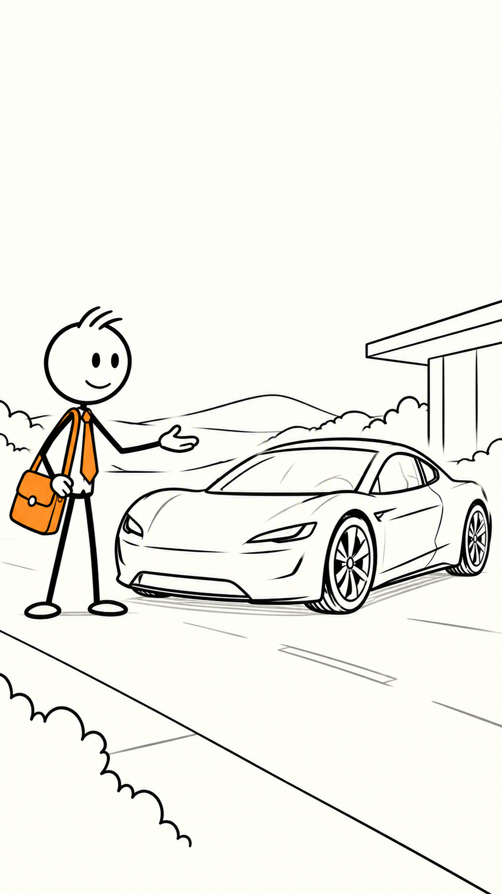

# Tesla Roadster example

This is the first complete AutoStickMan run. It uses the exact cream-paper stickman reference, 13 standalone generated frames, `en-US-BrianNeural`, and the fact-checked Tesla Roadster science workflow.

The rendered video is a keyframe flipbook animatic rather than full hand-drawn frame-by-frame animation. The source workflow documents which statements are established physics, Tesla-published claims, or not independently verified.

## Preview

### Generated YouTube-style scene

### Full storyboard

### Inline sample video

https://github.com/user-attachments/assets/2acaea92-e071-4d3a-a22e-e74cfaade0ab

[Download the repository copy of the sample MP4](tesla_roadster_stickman_movie_brian.mp4)

The contact sheet is only a visual index. The actual project contains 13 separate scene images in `frames/`, which are animated in sequence with Brian narration and captions.
