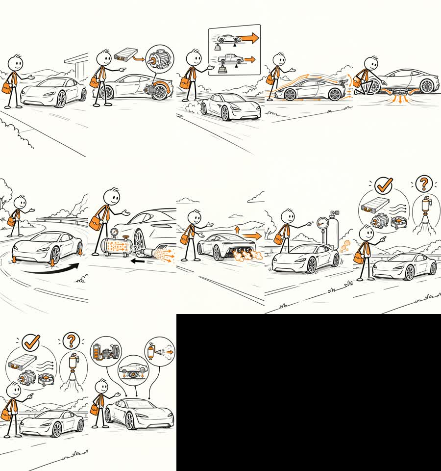

# Tesla Roadster example

This is the first complete AutoStickMan run. It uses the exact cream-paper stickman reference, 13 standalone generated frames, `en-US-BrianNeural`, and the fact-checked Tesla Roadster science workflow.

The rendered video is a keyframe flipbook animatic rather than full hand-drawn frame-by-frame animation. The source workflow documents which statements are established physics, Tesla-published claims, or not independently verified.

## Preview

[▶ Open the complete Tesla Roadster sample video](tesla_roadster_stickman_movie_brian.mp4)

[Download the sample MP4](https://github.com/aiwithenoch/AutoStickMan/raw/refs/heads/main/examples/tesla_roadster/tesla_roadster_stickman_movie_brian.mp4)

The contact sheet is only a visual index. The actual project contains 13 separate scene images in `frames/`, which are animated in sequence with Brian narration and captions.
